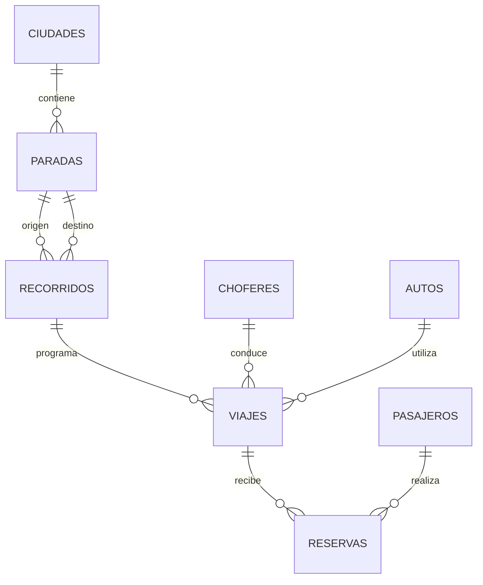

# Catálogo de recorridos y normalización

La migración `003_normalize_routes.sql` normaliza la información geográfica y elimina el contador redundante del pasajero. Se mantienen las entidades de identidad, perfiles, vehículos, turnos, viajes, reservas y auditoría que ya estaban separadas.

## Estructura



- `ciudades`: nombre único, sin diferencias por mayúsculas o espacios exteriores.
- `paradas`: pertenece a una ciudad; guarda una referencia de ubicación y si el punto fue precisado por el usuario. No se inventaron coordenadas ni se certificó una parada oficial.
- `recorridos`: une una parada de origen con una de destino. Cada sentido tiene su propia identidad. No guarda copias de los nombres de ciudades.
- `viajes.idRecorrido`: FK obligatoria. Se retiraron las columnas de texto `origen` y `destino`; la API obtiene esos nombres mediante relaciones para que historial y tarjetas sigan mostrándolos.
- `pasajeros.cantidadReservas`: se retiró porque depende de los registros de `reservas`. La vista `taxi.estadisticas_pasajeros` calcula la cantidad real, incluyendo todos los estados.

Las claves foráneas impiden viajes con recorridos inexistentes; los índices únicos impiden duplicados de ciudades y de pares de paradas. No se cambiaron roles ni estados ENUM a tablas independientes: ya contienen un único valor por campo, y no era necesario para eliminar estas dependencias.

`reservas.importeTotal` se conserva como el importe histórico de la compra; recalcularlo desde una tarifa actual cambiaría los registros anteriores. `viajes.asientosDisponibles` se conserva como estado operativo porque el sistema también admite pasajeros manuales. Se mantiene mediante transacciones y bloqueo de filas en las reservas; no es un contador de reservas. El usuario y los perfiles mantienen sus responsabilidades separadas.

## Opciones disponibles

| Corredor | Punto en San Salvador | Punto en destino |
| --- | --- | --- |
| San Salvador ↔ Perico | Dorrego y Jorge Newbery, zona vieja terminal | Centro / acceso a la feria; aproximado |
| San Salvador ↔ El Carmen | Independencia y Lavalle | Zona céntrica de El Carmen, referencia Cnel. Arenas; aproximado |

El catálogo contiene cuatro recorridos direccionales para los dos corredores. Los puntos de llegada también se usan como referencias de salida de los regresos y deben precisarse con los operadores. No se dibujó un trazado vial exacto ni se inventaron paradas intermedias.

No se crean viajes con chofer, horario o tarifa ficticios en la base de desarrollo. Cada chofer elige un recorrido del catálogo y publica su salida con la tarifa por asiento. El pasajero busca por ese mismo ID y ve los puntos de salida y llegada. La página principal presenta ambos corredores.

## API

`GET /api/recorridos` es público y devuelve el catálogo activo con ciudades, paradas y referencias. Los recorridos históricos inactivos no se ofrecen para nuevas salidas.

Para crear un viaje autenticado como chofer o administrador:

```json
{
  "idRecorrido": 1,
  "idChofer": 1,
  "idAuto": 1,
  "fechaSalida": "2026-11-10",
  "horaSalida": "10:00",
  "tarifaPorAsiento": 1000
}
```

Los números son ejemplos, no IDs fijos: tomar `idRecorrido` del catálogo y los IDs de chofer/auto de sus registros reales. El backend valida autorización, recorrido activo, auto y tarifa.

Buscar viajes: `GET /api/viajes/disponibles?idRecorrido=ID`, con JWT. El contrato deja de aceptar pares de nombres escritos libremente. Las propiedades `origen` y `destino` de las respuestas son derivadas, no columnas almacenadas.

## Migración y datos existentes

Ejecutar `npm run db:migrate:local` en desarrollo o `npm run db:migrate` con la conexión remota. Las migraciones 001 y 002 permanecen intactas. La 003 se aplica en la misma transacción que el historial de migraciones.

La migración vincula los pares conocidos al catálogo y reconoce `Jujuy` como San Salvador de Jujuy. Otros pares se conservan mediante recorridos históricos inactivos. Conserva IDs de viajes, usuarios, reservas, tarifas y asientos. Si un nombre vacío u otro dato inválido impide convertir un registro, se revierte la transacción completa en lugar de eliminarlo.

Se respaldó la base local en `/tmp/taxi-before-normalizacion.dump`, con permisos de lectura limitados al usuario, antes de aplicar el cambio. El respaldo contiene información privada y no se publica en Git. Para revisar o restaurar, usar una base separada y `pg_restore`; no restaurarlo sobre datos nuevos sin evaluar primero su contenido.

Esta migración retira columnas: para despliegue remoto, coordinar el cambio de backend y frontend y detener las instancias de la versión anterior durante la transición. No aplicarla mientras siga atendiendo solicitudes un backend que consulta las columnas antiguas. No se aplicó a Supabase en esta revisión.

## Verificaciones

- Migración desde la estructura anterior, con un viaje conocido y otro de ciudades no catalogadas: ambos conservados.
- Repetición de migraciones sin cambios.
- Catálogo con cuatro sentidos y paradas correctas.
- Publicación autenticada de salidas para los cuatro sentidos y búsqueda por ID.
- Rechazo de publicaciones sin un recorrido del catálogo.
- Consulta de todos los modelos sobre PostgreSQL real.
- Contador de reservas calculado y ausencia de las columnas redundantes.
- Reservas concurrentes sin sobreventa con el nuevo esquema.
- Prueba del frontend que comprueba ambas opciones y sus puntos de salida.

Las pruebas del frontend y la compilación pasan. No se pudo hacer la revisión visual adicional en el navegador porque su política bloqueó la observación de la pestaña; no se intentó eludir ese bloqueo.

La migración 004 suma habilitaciones_chofer (aprobación con FK al administrador) y auditorias.idUsuarioResponsable (FK al usuario actor). Ver [ADMINISTRACION.md](ADMINISTRACION.md).

### Estadisticas de transporte (migracion 005)

Las vistas `taxi.estadisticas_choferes` y `taxi.estadisticas_autos` devuelven `viajesRealizados` y `pasajerosTransportados`, incluso cero para entidades sin actividad. La vista auxiliar `estadisticas_viajes_transportados` agrupa cada viaje antes de sumar para evitar duplicados.

Se cuentan solo viajes FINALIZADO y se suman los asientos de reservas UTILIZADA. Representa servicios de transporte: la misma persona en dos viajes cuenta dos veces; no son pasajeros unicos. Cancelados, pendientes, confirmados y NO_PRESENTADO no suman pasajeros. El flujo actual de finalizar un viaje marca sus reservas activas como UTILIZADA; el chofer debe registrar los ausentes antes de finalizar.

Los datos se conservan en viajes/reservas y las vistas calculan totales al consultar, sin columnas de contadores redundantes. Las correcciones del historial se reflejan automaticamente.

API con JWT: `GET /api/choferes/:idChofer/estadisticas` (administrador o propio chofer) y `GET /api/autos/:id/estadisticas` (administrador o chofer con turno asignado a ese auto). No se permite acceso a pasajeros.

### Reservas de invitados (migracion 006)

La tabla `invitados` almacena nombre y telefono del titular sin crear una cuenta en usuarios/pasajeros. Cada reserva tiene exactamente un titular: `idPasajero` o `idInvitado`, mediante CHECK excluyente y claves foraneas. Un invitado identifica una sola reserva, sin fusionar personas por un telefono no verificado. Las estadisticas de chofer y auto incluyen sus asientos utilizados normalmente.

El comprobante aleatorio de 256 bits se entrega una sola vez; el servidor almacena su SHA-256 y lo excluye de respuestas y auditorias. Se envia en `X-Reserva-Token` a GET `/api/reservas/invitado` o PATCH `/api/reservas/invitado/cancelar`; no da acceso a ninguna cuenta ni otra reserva. La cancelacion web permite reservas pendientes/confirmadas sin pagar y antes de iniciar el viaje. Es idempotente.

El formulario guarda el ultimo comprobante en este navegador. Se puede copiar y pegar para recuperar la reserva desde otro dispositivo. El telefono no se verifica por SMS y el acceso depende de conservar el comprobante. La creacion usa bloqueo de la fila del viaje, calcula el precio en servidor y rechaza viajes sin habilitacion, pasados o sin asientos. El endpoint publico limita rafagas por IP en cada proceso (10 intentos por minuto). Para despliegues con varias instancias el limite debe centralizarse en el proxy o un almacen compartido.

### Ubicacion de invitados (migracion 007)

`invitados` incorpora latitud, longitud, precision en metros y ubicacionActualizadaAt, con CHECK de rangos y coherencia de nulos. No requiere usuario registrado. La web solicita permiso mediante geolocalizacion del navegador al pulsar Compartir / actualizar mi ubicacion desde el comprobante. Es una captura puntual; no usa watchPosition ni seguimiento en segundo plano. Se requiere HTTPS en despliegue, con la excepcion local de localhost del navegador.

PATCH `/api/reservas/invitado/ubicacion` exige el comprobante en X-Reserva-Token y `{ compartir: true, latitud, longitud, precision }`. Solo admite reservas y viajes activos; no se aceptan datos de otra reserva. `{ compartir: false }` borra los datos incluso si la reserva termino. El hook de cierre/cancelacion/ausencia de reservas tambien borra la ubicacion. No se conserva historial de posiciones en auditorias.

La ubicacion se incluye en las reservas privadas del chofer asignado y administracion, nunca en el catalogo publico. Un evento Socket.IO notifica al chofer para recargar su mapa, incluyendo invitados que ya pagaron. La pantalla muestra fecha de captura y precision para distinguir una posicion antigua de una actual. El permiso real y la exactitud dependen del dispositivo; las pruebas automatizadas simulan permiso concedido y denegado.
